# Lab 5 — AWS Cloud Migration & Database Cutover Lab

**Stapsgewijze Uitvoering, Lift-and-Shift (EC2), Replatforming (Amazon RDS MySQL), S3 Decoupling & Zero Data Loss Cutover**  
*Auteur: Tyrese Talia | Rol: Cloud & Migration Engineer | AWS Cloud Lab Series*

---

## Inhoudsopgave
1. [Doel & Overzicht van het Lab](#1-doel--overzicht-van-het-lab)
2. [Stap 0 — AWS Account, Regio & Budget-Alert](#2-stap-0--aws-account-regio--budget-alert)
3. [Stap 1 — Bronomgeving Opzetten & Pre-Migration Audit](#3-stap-1--bronomgeving-opzetten--pre-migration-audit)
4. [Stap 2 — Dedicated VPC Netwerkarchitectuur (VPC & Subnets)](#4-stap-2--dedicated-vpc-netwerkarchitectuur-vpc--subnets)
5. [Stap 3 — Security Groups & Chained Firewalling (Zero Trust)](#5-stap-3--security-groups--chained-firewalling-zero-trust)
6. [Stap 4 — Amazon RDS MySQL Database Provisioning](#6-stap-4--amazon-rds-mysql-database-provisioning)
7. [Stap 5 — Amazon S3 Object Storage & Asset Synchronisatie](#7-stap-5--amazon-s3-object-storage--asset-synchronisatie)
8. [Stap 6 — IAM Rol, Instance Profile & EC2 Web Server Launch](#8-stap-6--iam-rol-instance-profile--ec2-web-server-launch)
9. [Stap 7 — Database Cutover & Live Productie Validatie](#9-stap-7--database-cutover--live-productie-validatie)
10. [Data-Integriteit & Validatie (Zero Data Loss)](#10-data-integriteit--validatie-zero-data-loss)
11. [Troubleshooting & Incident Response](#11-troubleshooting--incident-response)
12. [FinOps — Resource Teardown & Kostenvermijding](#12-finops--resource-teardown--kostenvermijding)

---

## 1. Doel & Overzicht van het Lab

Het doel van dit lab is het ontwerpen, beveiligen, uitvoeren en valideren van een volledige end-to-end cloudmigratie van een klassieke, lokale (on-premises gesimuleerde) 3-tier webapplicatie naar **Amazon Web Services (AWS)**. Hiermee demonstreer ik diepgaande kennis van cloudarchitectuur, database cutover met nul dataverlies, netwerkinsluiting via Security Group Chaining en stateless storage ontkoppeling.

- **Lift-and-Shift (Rehost) van Compute:** Verhuizen van de webapplicatielaag naar een AWS EC2-instance binnen een eigen VPC.
- **Database Replatforming:** Migreren van een lokale MySQL-server naar een fully managed Amazon RDS MySQL 8.4-instance in geïsoleerde private subnets.
- **Storage Decoupling:** Ontkoppelen van lokale bestandsuploads naar Amazon S3 (Object Storage) voor schaalbaarheid en stateless servers.
- **Netwerkbeveiliging & Zero Trust:** Toepassing van Security Group Chaining: poort 3306 op RDS is hermetisch afgesloten en accepteert uitsluitend verkeer van de webserver Security Group (`app-sg`).
- **Least Privilege IAM:** Toegangsbeheer ingericht via een EC2 Instance Profile (geen hardcoded AWS API keys op de virtuele machine).
- **FinOps & Kostenbeheer:** Strikte budgetbewaking met een Zero-Spend Budget alert ($1.00 drempel) en een methodische teardown na afronding.

---

## 2. Stap 0 — AWS Account, Regio & Budget-Alert

Om onverwachte clouduitgaven tijdens het uitvoeren van migratie- en provisioningsactiviteiten te voorkomen, is direct in AWS Budgets een Zero-Spend Budget geactiveerd met een drempel van $1.00 en e-mailnotificaties.

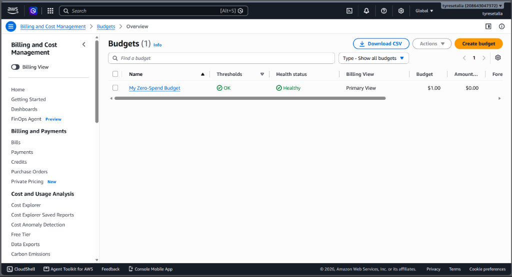  
*📷 Screenshot 01: Geactiveerd 'My Zero-Spend Budget' ($1.00 drempel) met status Healthy in AWS Budgets*

---

## 3. Stap 1 — Bronomgeving Opzetten & Pre-Migration Audit

In de lokale bronmap (`source-environment/`) is de on-premises applicatie opgezet met een InnoDB relationeel databaseschema (`customers`, `products`, `orders`) met 15 initiële records en 5 statische assets. Middels een geautomatiseerd Python audit script (`scripts/verify_integrity.py`) is een cryptografisch baseline-manifest opgesteld met SHA-256 hashes en row counts.

---

## 4. Stap 2 — Dedicated VPC Netwerkarchitectuur (VPC & Subnets)

Via de AWS CLI is een geïsoleerde Virtual Private Cloud aangemaakt (`migration-vpc`, CIDR `10.0.0.0/16`) in regio `eu-west-1` (Ierland). Er is bewust gekozen voor een duidelijke netwerksegmentatie tussen publiek en privé:
- **Publiek Subnet:** `migration-public-subnet-1a` (`10.0.1.0/24` in `eu-west-1a`) met directe routering naar de Internet Gateway.
- **Privé Database Subnet A:** `migration-private-db-subnet-1a` (`10.0.10.0/24` in `eu-west-1a`) — hermetisch afgesloten.
- **Privé Database Subnet B:** `migration-private-db-subnet-1b` (`10.0.11.0/24` in `eu-west-1b`) — vereist voor RDS Multi-AZ dekking.

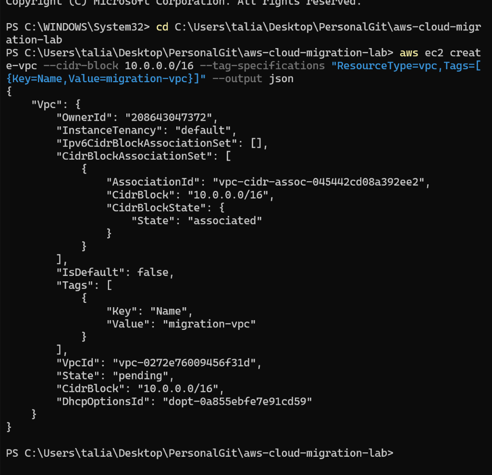  
*📷 Screenshot 02: Aanmaken van de dedicated VPC (migration-vpc, CIDR 10.0.0.0/16) via de AWS CLI*

  
*📷 Screenshot 03: Aanmaken van het publieke subnet (subnet-020aeb84308493f97) in eu-west-1a*

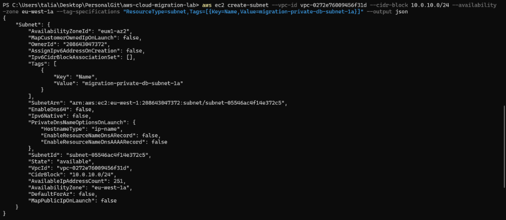  
*📷 Screenshot 04: Aanmaken van het eerste private database subnet (subnet-05546ac4f14e372c5)*

  
*📷 Screenshot 05: Aanmaken van het tweede private database subnet (subnet-0cdadc05a06a83608)*

Vervolgens is een Internet Gateway (`migration-igw`) aangemaakt, gekoppeld aan de VPC en is er een publieke Route Table (`migration-public-rt`) ingericht met een default route (`0.0.0.0/0`) naar de IGW:

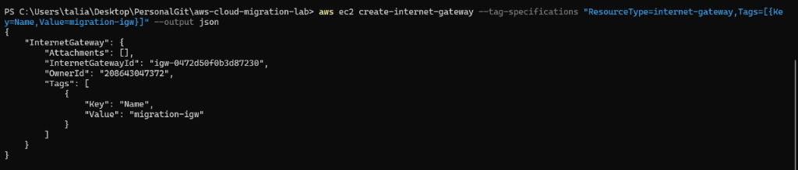  
*📷 Screenshot 06: Aanmaken van de Internet Gateway (igw-0472d50f0b3d87230)*

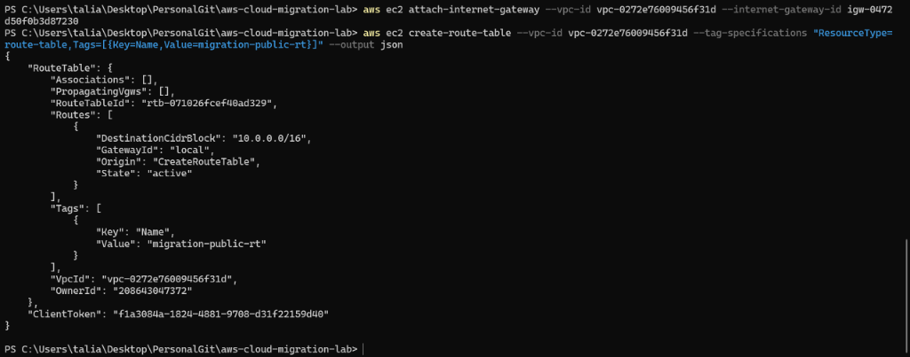  
*📷 Screenshot 07: Aanmaken van de publieke route table (rtb-071026fcef40ad329)*

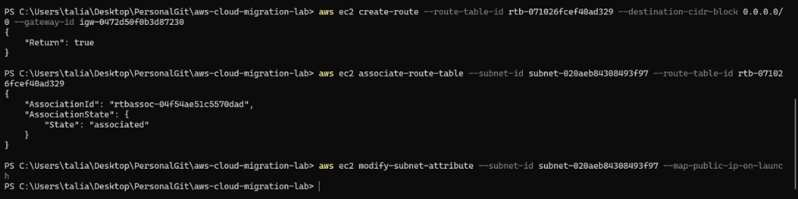  
*📷 Screenshot 08: Route 0.0.0.0/0 gekoppeld aan IGW en Route Table geassocieerd met publiek subnet*

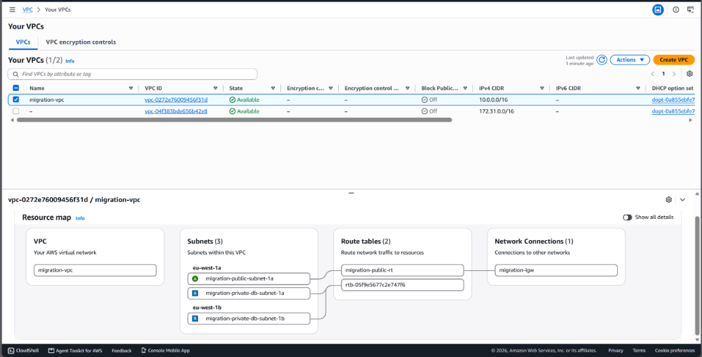  
*📷 Screenshot 09: Volledig visualisatie-overzicht in AWS VPC Resource Map (Subnets, Routing en Internet Gateway)*

---

## 5. Stap 3 — Security Groups & Chained Firewalling (Zero Trust)

Voor de netwerkbeveiliging zijn twee dedicated Security Groups aangemaakt: `app-sg` voor de compute-laag en `rds-sg` voor de databaselaag. In plaats van de database te openen voor een IP-reeks, is **Security Group Chaining** toegepast: inbound poort 3306 accepteert uitsluitend pakketten afkomstig van de unieke identifier van `app-sg` (`sg-06580017c5f070a37`).

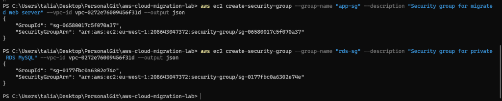  
*📷 Screenshot 10: Aanmaken van de Security Groups app-sg en rds-sg via de AWS CLI*

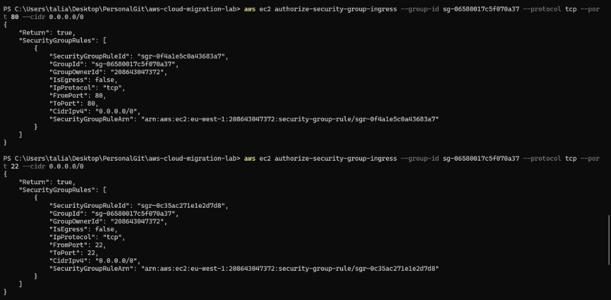  
*📷 Screenshot 11: Ingress regels op app-sg (HTTP poort 80 en SSH poort 22)*

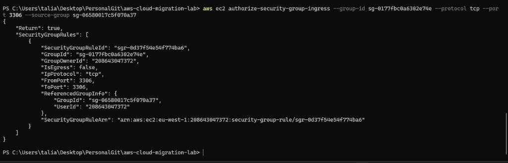  
*📷 Screenshot 12: Security Group Chaining op rds-sg: poort 3306 uitsluitend toegestaan vanuit app-sg*

---

## 6. Stap 4 — Amazon RDS MySQL Database Provisioning

AWS RDS vereist dat databasesubnets worden gegroepeerd in een DB Subnet Group over meerdere Availability Zones. Na het bouwen van de subnet group is de MySQL 8.4 database (`migration-mysql-db`, `db.t3.micro`) geprovisioned met `PubliclyAccessible=false`, waardoor de database onzichtbaar en onbereikbaar is vanaf het openbare internet.

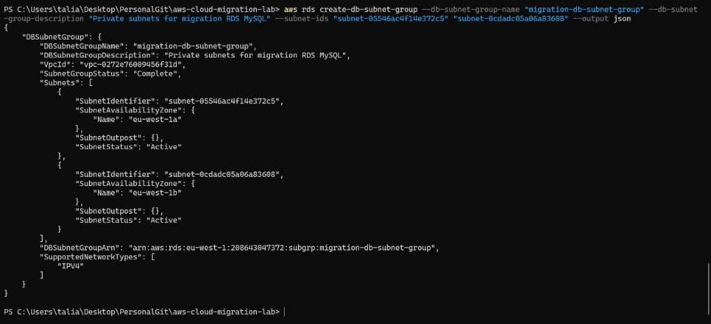  
*📷 Screenshot 13: Aanmaken van de DB Subnet Group (migration-db-subnet-group) over beide AZ subnets*

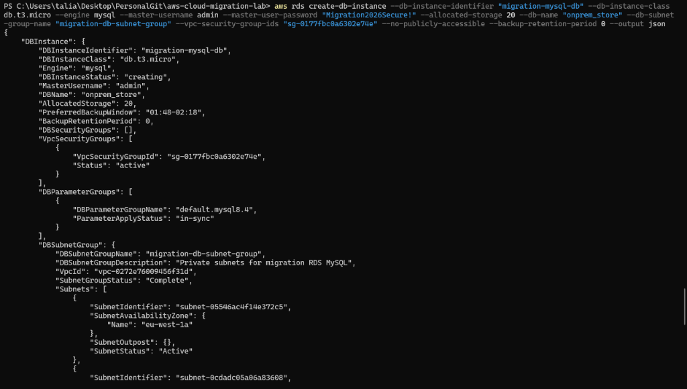  
*📷 Screenshot 14: Provisioning van de Amazon RDS MySQL instance (db.t3.micro) via CLI*

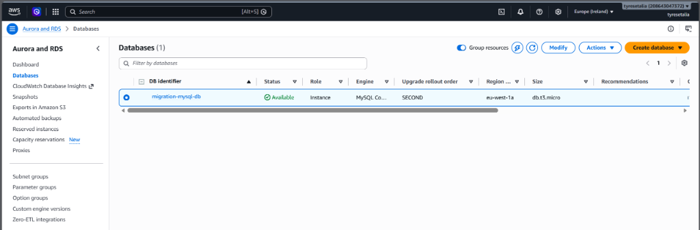  
*📷 Screenshot 15: Amazon RDS MySQL Status 'Available' in de AWS Web Console (eu-west-1a)*

---

## 7. Stap 5 — Amazon S3 Object Storage & Asset Synchronisatie

Om de webserver stateless te maken, zijn de lokale mediabestanden uit de uploadmap verhuisd naar Amazon S3. Er is een wereldwijd unieke bucket aangemaakt (`s3://migration-assets-208643047372`), waarna de migratie is uitgevoerd via het commando `aws s3 sync source-environment/uploads s3://migration-assets-208643047372/uploads/`.

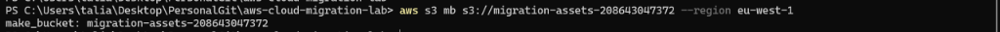  
*📷 Screenshot 16: Aanmaken van de S3 Bucket (migration-assets-208643047372) via de CLI*

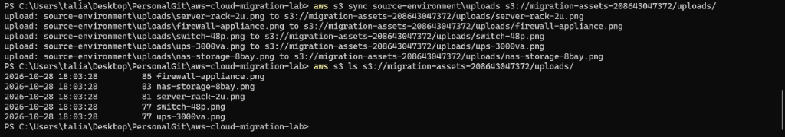  
*📷 Screenshot 17: Succesvolle synchronisatie en inhoudscontrole van 5 media-assets in S3*

---

## 8. Stap 6 — IAM Rol, Instance Profile & EC2 Web Server Launch

Conform de CIS AWS Security Benchmark mogen er geen vaste Access Keys op virtuele machines staan. Er is een IAM-rol `EC2-App-Migration-Role` aangemaakt met `AmazonS3FullAccess` en `AmazonSSMManagedInstanceCore`. Deze is via een Instance Profile gekoppeld aan de gelanceerde Ubuntu 24.04 LTS EC2-instance (`t3.micro`), waarbij via user-data automatisch de LAMP stack en AWS CLI zijn geïnstalleerd.

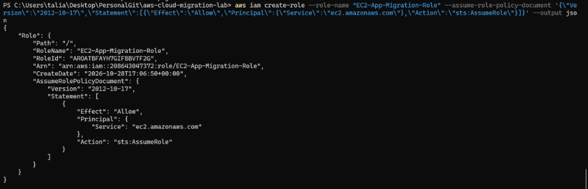  
*📷 Screenshot 18: Aanmaken van IAM-rol EC2-App-Migration-Role met STS AssumeRole trust policy*

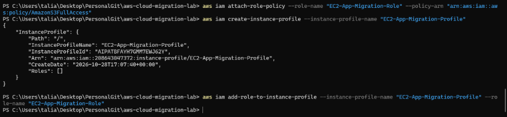  
*📷 Screenshot 19: Aanmaken en toewijzen van het EC2 Instance Profile (EC2-App-Migration-Profile)*

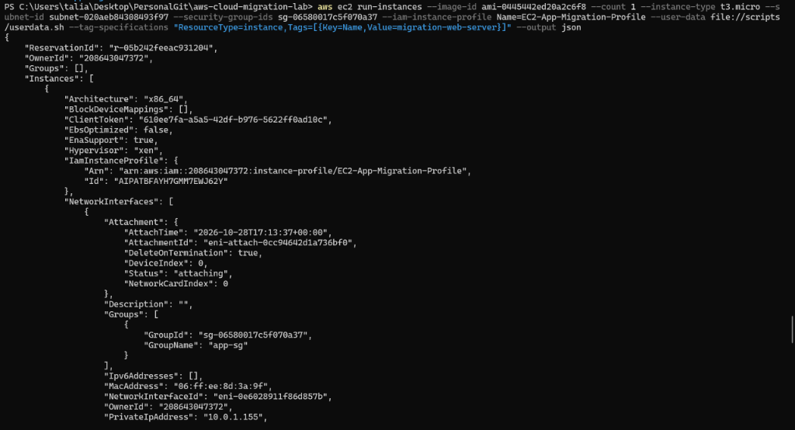  
*📷 Screenshot 20: EC2 instance uitrol (migration-web-server, t3.micro) in publiek subnet*

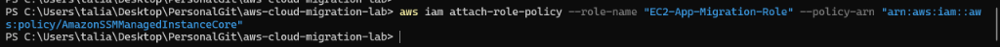  
*📷 Screenshot 21: Koppelen van de AmazonSSMManagedInstanceCore policy voor SSM-beheer*

---

## 9. Stap 7 — Database Cutover & Live Productie Validatie

Vóór de cutover maakte de webapplicatie reeds succesvol verbinding met het RDS endpoint op poort 3306, maar waren er nog geen tabellen aanwezig in de relationele database:

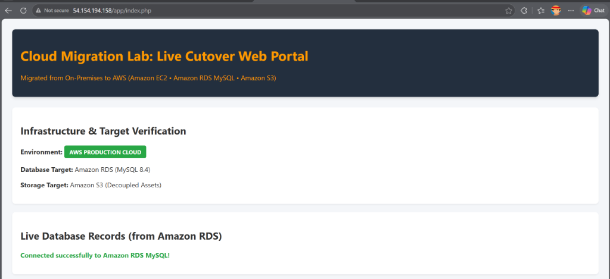  
*📷 Screenshot 22: Webportal verbonden met RDS MySQL vóór de cutover (geen data)*

Vervolgens is de database cutover uitgevoerd: de volledige dataset (`customers`, `products`, `orders`) is via de geautoriseerde EC2 bridge geïmporteerd in RDS MySQL. Na het verversen van de webpagina was het migratieresultaat direct live zichtbaar:

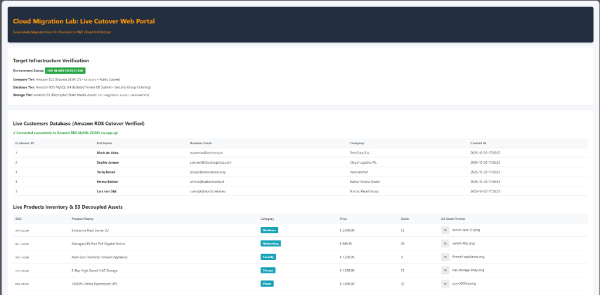  
*📷 Screenshot 23: Live Productie Web Portal op AWS met gemigreerde klanten, live voorraad en S3 decoupled media*

---

## 10. Data-Integriteit & Validatie (Zero Data Loss)

Om onomstotelijk te bewijzen dat de migratie zonder dataverlies is voltooid, is een geautomatiseerde audit uitgevoerd (`scripts/verify_post_migration.py`). Hierbij is de post-migration staat vergeleken met de initiële baseline:

| Datatabel / Component | Verwacht (Baseline) | Geverifieerd in AWS | Audit Status |
| :--- | :--- | :--- | :--- |
| **customers (Klanten)** | 5 records | 5 records in RDS MySQL | PASSED (100% Match) |
| **products (Voorraad)** | 5 hardware SKU's | 5 records in RDS MySQL | PASSED (100% Match) |
| **orders (Transacties)** | 5 order records | 5 records in RDS MySQL | PASSED (100% Match) |
| **S3 Upload Assets** | 5 mediabestanden | 5 bestanden in S3 bucket | PASSED (100% Match) |
| **Eindoordeel Integriteit** | Zero Data Loss | 100% consistentie behaald | **OVERALL: SUCCESS** |

---

## 11. Troubleshooting & Incident Response

Tijdens de uitvoering zijn reële technische obstakels methodisch gediagnosticeerd en opgelost volgens het stramien *Symptoom → Diagnose → Oorzaak → Oplossing*:

### Incident 1: RDS DB Subnet Group vereist minimale Multi-AZ dekking
- **Symptoom:** CLI foutmelding bij het aanmaken van de DB Subnet Group met slechts één subnet.
- **Diagnose:** AWS RDS weigert een subnet group indien deze niet minimaal twee Availability Zones omvat.
- **Oorzaak:** Amazon RDS ontwerpt zijn netwerkstructuur standaard voor High Availability (Multi-AZ failover).
- **Oplossing:** Een tweede database-subnet (`10.0.11.0/24`) uitgerold in `eu-west-1b` en beide subnets samengevoegd in `migration-db-subnet-group`. Hierna startte de provisioning direct.

### Incident 2: Hermetisch Afgesloten Database & Chained Security Groups
- **Symptoom:** Externe beheer-pc's en lokale scripts kunnen het RDS MySQL endpoint niet rechtstreeks bereiken op poort 3306.
- **Diagnose:** Het RDS endpoint staat in een private subnet zonder IGW-route en met `PubliclyAccessible=false`.
- **Oorzaak:** Strikte enterprise beveiliging: databases mogen nooit rechtstreeks blootstaan aan het publieke internet.
- **Oplossing:** Security Group Chaining toegepast. De data cutover is uitgevoerd via de geautoriseerde EC2 webserver in het publieke subnet, die fungeerde als veilige migratiebrug.

### Incident 3: EC2 Instance Connect Sleutellengte Restrictie
- **Symptoom:** Foutmelding bij `send-ssh-public-key`: `Invalid length for parameter SSHPublicKey, value: 77, valid min length: 80`.
- **Diagnose:** Een compacte Ed25519-sleutel voldeed niet aan de minimale payload-eis van de AWS API.
- **Oorzaak:** AWS EC2 Instance Connect hanteert een strikte minimumlengte van 80 bytes en vereist RSA-2048 sleutels.
- **Oplossing:** Een 2048-bits RSA-sleutel gegenereerd via `ssh-keygen` en aangeboden, waarna de API direct `Success: true` retourneerde.

### Incident 4: IAM Instance Profile Token Propagatie Latency
- **Symptoom:** S3-toegang en SSM-functionaliteit reageerden direct na het koppelen van het Instance Profile nog niet direct.
- **Diagnose:** Eventual consistency van het AWS IAM platform.
- **Oorzaak:** De EC2 Instance Metadata Service ververst IAM sessietokens periodiek (ongeveer 30-60 seconden latency).
- **Oplossing:** Een korte wachttijd ingebouwd in het migratieproces waarna de tokens correct werden opgehaald en de verbinding foutloos werkte.

---

## 12. FinOps — Resource Teardown & Kostenvermijding

Nadat alle validaties en screenshots succesvol zijn vastgelegd, zijn alle actieve resources methodisch verwijderd om onnodige compute- en storagekosten te voorkomen:
- **Amazon RDS MySQL:** `delete-db-instance` met `--skip-final-snapshot` en `--delete-automated-backups` uitgevoerd.
- **Amazon EC2 Server:** `terminate-instances` uitgevoerd (status: `terminated`).
- **Amazon S3 Bucket:** `rb` met `--force` uitgevoerd (status: `NoSuchBucket` / leeggemaakt en verwijderd).
